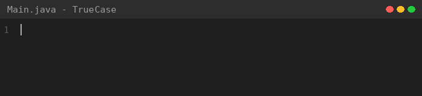

<p align="center"></p>

# TrueCase

Type your code in whatever case your hands land in. TrueCase snaps each
word to its correct casing the moment you finish it. No suggestion popup,
no Tab to accept, no break in your flow.



```java
// you type:
public static void main(string[] args) { system.out.println("hello"); }
// TrueCase leaves behind:
public static void main(String[] args) { System.out.println("hello"); }
```

## What it corrects

Three sources of truth, in priority order:

1. **Your own identifiers.** Declare `MyClass` or `maxRetryCount` once, and
   every `myclass` or `maxretrycount` after that is corrected to match.
   This works in every supported language because it learns from the file
   you are in, not from a lookup table.
2. **Keywords.** `PUBLIC` becomes `public`, `TRUE` becomes `true` in
   Java but `TRUE` in SQL, `true` becomes `True` in Python.
3. **Standard library names.** `system` becomes `System`,
   `arraylist` becomes `ArrayList`, `json` becomes `JSON`,
   `vec` becomes `Vec` in Rust, and so on.

## What it never does

The rule is simple: **when unsure, don't change anything.**

- It never invents casing from a naming convention. A correction only
  happens when exactly one correct casing is known to exist.
- If two casings of the same word already live in your file, both stay.
- Strings, comments, char literals, text blocks and template literals are
  never touched.
- A mistaken fix is one `Ctrl+Z` away, and undoing a fix teaches TrueCase
  to leave that word alone for the rest of the session.
- One-letter words and numeric literals are ignored.

## Languages

Verified with the test suite (lexer rules, keyword tables and standard
library tables are all covered by automated tests):

| Deep support (keywords + standard library) | Keywords + your identifiers |
| --- | --- |
| Java, C, C++, JavaScript, TypeScript, Python, Rust, C#, Kotlin, Swift, PHP, Ruby | Go, SQL, Lua, R, Shell (Bash) |

JSX/TSX files are handled through the JavaScript/TypeScript rules.

Known limits, honestly:

- Identifiers inside JavaScript template-literal expressions
  (`` `hello ${name}` ``) and Python f-strings are left alone.
- Corrections trigger on word-finishing characters (space, punctuation,
  Enter). A word at the very end of a file is corrected when the next
  character lands.
- Language support is hand-tuned, not grammar-complete. Exotic syntax in
  less common languages may be treated as plain code, which only ever
  means "no correction", never a wrong one.

## Turning it off

- Click **TrueCase** in the status bar to toggle it.
- Or run `TrueCase: Toggle On/Off` from the command palette.

`TrueCase: Fix Casing in This File` sweeps the whole open file at once,
as one undoable edit.

## Settings

| Setting | Default | What it does |
| --- | --- | --- |
| `truecase.enabled` | `true` | Master switch. |
| `truecase.languages` | all supported | Language IDs TrueCase works in. |
| `truecase.fixKeywords` | `true` | Correct keywords typed in the wrong case. |
| `truecase.fixLibrary` | `true` | Correct standard library names. |
| `truecase.fixDocumentIdentifiers` | `true` | Correct identifiers to match this file. |
| `truecase.extraSymbols` | `{}` | Your own canonical names per language. |
| `truecase.maxFileSizeKB` | `512` | Larger files are left alone. |

Add your own project names so they are corrected too:

```json
"truecase.extraSymbols": {
  "java": ["MyApiClient", "OrderService"],
  "go": ["Cfg"]
}
```

## How it works

A small lexical scanner maps out comments and strings, a regex pass indexes
the identifiers in your file, and a conservative rule chain decides whether
a finished word has exactly one defensible casing. Everything runs locally,
on every keystroke, with no network, no language server and no telemetry.

## License

MIT
